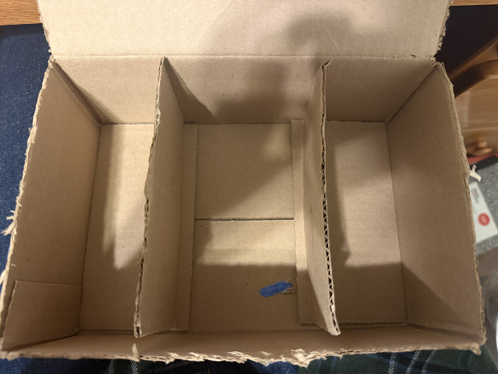
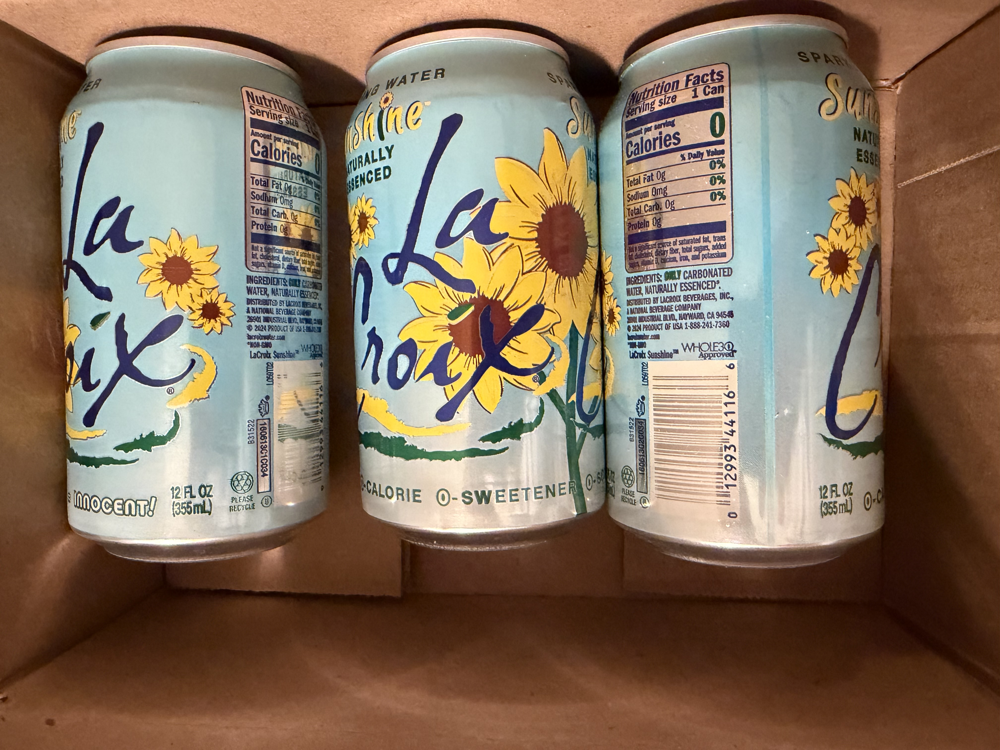
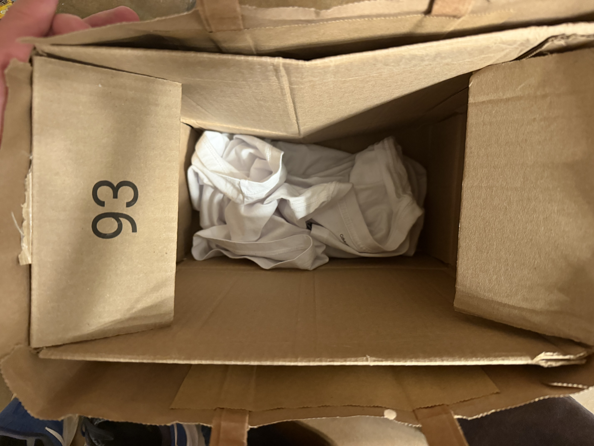
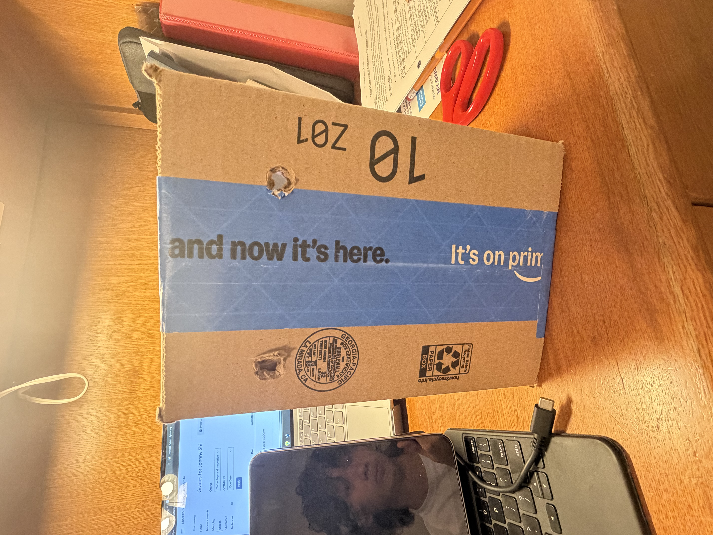

# Cardboard Reuse #

## This is simply a box with three categories, the width of the box is about the length of a pen. So I can put my stationaries by categorizing them into pen, pencil, and markers. ##

## My friend Jayden lost his laundry bag for third time as people often forgot to return it after they borrow it when Jayden left it the laundry room. Therefore, I made this low-cost laundry bag with a paper bag and cardboard so that he can use it without the concern of losing it again. ##

## This is a cans container for you to stock your drinks. My friend Andy complained that there often isn’t enough space to put drinks, so I made this so that it can be put in the fridge and prevent sparkling drinks for rolling.

## This is a simple welding helmet that protects welder’s eyes from fire when working.

